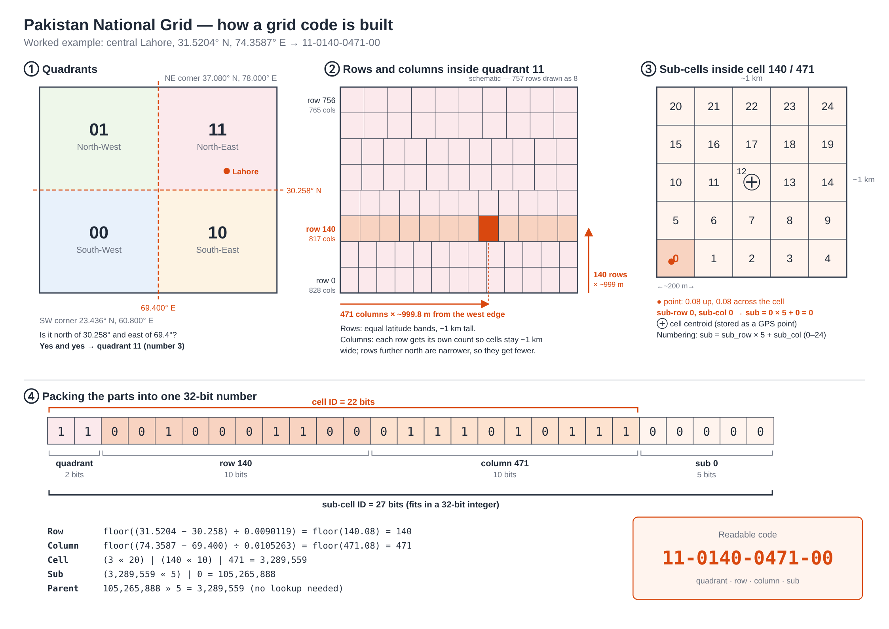

# Pakistan National Grid (`pakgrid`) — Project Documentation

| | |
|---|---|
| **Status** | v0.1 library implemented (Python package `pakgrid`, see the README); scope will be refined as the project develops |
| **Grid version** | v1 (proposed, not yet frozen) |
| **First user** | Dukandaari app (delivery logistics) |
| **Licence** | Open source (MIT or Apache-2.0, to be decided) |
| **Last updated** | 2026-10-27 |



*Schematic of the grid, worked through for central Lahore
(`11-0140-0471-00`). Printable A4 version: [docs/grid_schematic.pdf](docs/grid_schematic.pdf).*

---

## Contents

1. [Overview](#1-overview)
2. [Scope of v0.1](#2-scope-of-v01)
3. [Grid design](#3-grid-design)
4. [Identifiers](#4-identifiers)
5. [Pre-built catalogue and database](#5-pre-built-catalogue-and-database)
6. [Library architecture](#6-library-architecture)
7. [Public interface](#7-public-interface)
8. [How a lookup works](#8-how-a-lookup-works)
9. [Handling GPS inaccuracy](#9-handling-gps-inaccuracy)
10. [Rider navigation](#10-rider-navigation)
11. [From request to response](#11-from-request-to-response)
12. [Performance](#12-performance)
13. [Using it in Dukandaari](#13-using-it-in-dukandaari)
14. [Validation and testing](#14-validation-and-testing)
15. [Roadmap](#15-roadmap)
16. [Open decisions](#16-open-decisions)
17. [Changes from the initial README spec](#17-changes-from-the-initial-readme-spec)
18. [Glossary](#18-glossary)

---

## 1. Overview

### 1.1 The problem

Addresses in Pakistan are mostly free text, for example *"near the green
mosque, gali 3, behind the PSO pump"*. Many areas have no street names or house
numbers, so couriers phone customers for directions. That causes delays,
failed deliveries and wasted fuel.

### 1.2 The idea

A **fixed national grid** in which every location in Pakistan belongs to
exactly one permanently numbered block:

- **4 quadrants** divide the country.
- About **2.5 million cells** of ~1 km × 1 km make up the quadrants.
- About **62.5 million sub-cells** of ~200 m × 200 m make up the cells.
- Every cell and sub-cell has a fixed ID, fixed boundaries and a fixed
  **centroid** (centre point) with a real GPS coordinate.

A location can then be written as a short code, such as `11-0140-0471-00`.
For door-level precision, the code can carry an offset from the block's
centroid: `11-0140-0471-00 W23 S18` (23 m west and 18 m south of the block's
centre).

### 1.3 Long-term vision

A **standalone, open-source mapping platform for Pakistan** built around the
grid, with a public API that any app can use: delivery apps, courier companies,
emergency services, government bodies. **Dukandaari is the first user.**

```
        Pakistan Grid Platform (open source)
  ┌──────────────────────────────────────────┐
  │ Grid engine  ·  Map  ·  Search  ·  Routes │
  └───────────────────┬──────────────────────┘
                      │ Public API + SDKs
     ┌────────────────┼────────────────┐
  Dukandaari     Courier firms     Anyone else
```

The platform builds on existing open data and tools rather than recreating
Google Maps:

- **OpenStreetMap** for roads, buildings and place names
- **MapLibre** to display the map
- **OSRM** or **Valhalla** for road routing
- **Nominatim** for place search

What is new is the **national grid address layer** on top.

---

## 2. Scope of v0.1

v0.1 is the **grid itself**: a Python library and a static database.

| # | Requirement | How it is met | Section |
|---|-------------|---------------|---------|
| 1 | Divide the territory into quadrants | 4 quadrants split at the national midlines | §3.2 |
| 2 | Cells inside each quadrant | ~1 km × 1 km cells | §3.3–3.4 |
| 3 | Sub-cells inside each cell | 5 × 5 = 25 sub-cells of ~200 m × 200 m | §3.5 |
| 4 | Sizes may flex to fill the quadrant | Each row's cells are stretched slightly so the row fills the quadrant exactly, leaving no gaps or partial cells | §3.3–3.4 |
| 5 | Every cell unique | Cell ID (quadrant + row + column) is unique across the whole grid | §4.5 |
| 6 | Every sub-cell unique | Sub-cell ID (cell ID + index 0–24) is unique across the whole grid | §4.5 |
| 7 | Centroids for every cell and sub-cell | Area-weighted centre on the WGS 84 ellipsoid | §3.7 |
| 8 | Corrects for Earth's curvature | All sizes measured on the WGS 84 ellipsoid | §3.3–3.4 |
| 9 | Linked to real GPS points | Every boundary is a line of latitude or longitude | §3.6 |
| 10 | IDs and boundaries pre-determined | Full catalogue generated before use | §5 |
| 11 | Own static database as single source of truth | One read-only, versioned SQLite file | §5 |
| 12 | Python compatible | Pure Python 3.10+, standard library only | §6 |
| 13 | Efficient links between levels | The parent is encoded in the child's ID, so no link tables are needed | §4 |
| 14 | No front end for now | Library and command-line tools only | — |

**Out of scope for v0.1:**

- website, public HTTP API, search, road routing
- personal data of any kind (for example CNIC)

---

## 3. Grid design

### 3.1 The bounding rectangle

The grid covers a latitude/longitude rectangle that contains all of Pakistan.

| Corner | GPS point | Approximate location |
|---|---|---|
| South-West | 23.436° N, 60.800° E | Gulf of Oman / Arabian Sea, ~200 km south of Chabahar (Iran) |
| North-West | 37.080° N, 60.800° E | North-east Iran, near the Turkmenistan border |
| North-East | 37.080° N, 78.000° E | Xinjiang, China, in the Kunlun mountains north of the Karakoram |
| South-East | 23.436° N, 78.000° E | Madhya Pradesh, India, ~60 km east of Bhopal |

- The **south edge** is the Tropic of Cancer, just south of Pakistan's
  southern tip.
- The **north edge** matches Pakistan's northern limit.
- The **east edge** (78.0° E) includes all of Gilgit-Baltistan, up to the
  Karakoram Pass (~77.8° E). It was moved from 77.0° E after checking the
  grid on the map viewer, which showed 77.0° E cut off a corner of Baltistan.

**Area:** 2,497,710 km² on the WGS 84 ellipsoid. Pakistan, including
Gilgit-Baltistan and AJK, is about 882,000 km², or **~35%** of the rectangle.
The rest covers parts of Iran, Afghanistan, China, India and the Arabian Sea.
Every cell and sub-cell is flagged as inside Pakistan, on its border, or outside
(§5.6); IDs are the same either way.

### 3.2 Quadrants

The rectangle is split at its midlines: **30.258° N** and **69.400° E**, the
middle of the rectangle in each direction.

| Code | Quadrant | Example region | Area (km²) | Rows | Cells |
|------|----------|----------------|-----------:|-----:|------:|
| `00` | South-West | Karachi, Quetta, Gwadar, Hyderabad, Sukkur | 645,709 | 756 | 645,806 |
| `01` | North-West | Pishin, Chaman (northern Balochistan); mostly Afghanistan and Iran | 603,146 | 757 | 603,405 |
| `10` | South-East | Multan, Bahawalpur, Dera Ghazi Khan, Thar | 645,709 | 756 | 645,806 |
| `11` | North-East | Lahore, Islamabad, Peshawar, Zhob, Gilgit-Baltistan | 603,146 | 757 | 603,405 |
| | **Total** | | **2,497,710** | | **2,498,422** |

- In each code, the **first bit** is east (1) or west (0) and the **second
  bit** is north (1) or south (0).
- The southern quadrants are larger because a degree of longitude is wider
  further south.
- The midlines are geometric, not regional: Quetta (30.18° N) is just south of
  30.258° N, and Karachi (67.0° E) is west of 69.4° E, so both are in `00`.
  Check a place's quadrant with `pakgrid locate` or the map viewer.

### 3.3 Rows (north–south)

For each quadrant:

1. Measure its height along a meridian on the WGS 84 ellipsoid (~756 km).
2. **Number of rows** = height ÷ 1,000 m, rounded to the nearest whole number.
3. Split the quadrant into that many **equal latitude bands**.

Result: every row is **999.0–1,000.4 m** tall, and the rows exactly fill the
quadrant. Rows are numbered from 0 at the south edge.

### 3.4 Columns (east–west) and the curvature correction

Lines of longitude converge towards the pole. One degree of longitude is
~102 km wide near Karachi but only ~89 km in Gilgit-Baltistan. So **every row
gets its own number of columns**:

1. Measure the quadrant's width along the row's middle latitude on the
   ellipsoid.
2. **Number of columns** = width ÷ 1,000 m, rounded to the nearest whole number.
3. Split the row into that many **equal longitude spans**.

Result: every cell is **999.3–1,000.7 m** wide, and every row fills the
quadrant exactly. Columns are numbered from 0 at the west edge. In quadrant
`11`, for example, row 0 has 828 columns, row 140 has 817, and row 756 has 765.
The maximum anywhere is 879.

Because column counts differ from row to row, cells in neighbouring rows are
**offset sideways, like bricks in a wall**. This matters for neighbours (§8.4)
and is why "nearest centroid" must not be used to find a cell (§8.3).

### 3.5 Sub-cells

Each cell is split into a **5 × 5** grid of equal latitude and longitude steps,
giving 25 sub-cells of ~200 m × 200 m.

```
 20  21  22  23  24     ← north
 15  16  17  18  19
 10  11  12  13  14     sub = sub_row × 5 + sub_col
  5   6   7   8   9
  0   1   2   3   4     ← south (sub_row 0)
 west             east
```

### 3.6 Boundaries and the edge rule

- Every boundary is a line of constant latitude or constant longitude, so every
  corner is an exact GPS coordinate. No map projection is needed to convert
  back.
- **Edge rule:** a point exactly on a boundary belongs to the cell or sub-cell
  to its **north or east**. Points on the outer north and east edges of the
  rectangle belong to the last row or column. This guarantees every point maps
  to exactly one block.

### 3.7 Centroids: the fixed points of the grid

Every cell and sub-cell has a **centroid**: the area-weighted centre of the
block on the WGS 84 ellipsoid. Centroids are:

- **real GPS coordinates** (WGS 84, the same system used by GPS, phones and
  Google Maps)
- **precise to ~1 cm**, stored in units of 10⁻⁷ degree
- **permanent**: computed once when the database is built and never changed
  within a grid version

The area-weighted centroid sits slightly south of the plain midpoint, because
the southern half of a block is fractionally wider. The difference is ~0.8 cm
for a 1 km cell, but the correct value is the one stored.

**Worked example, central Lahore:**

| | South / West edge | North / East edge | Centroid |
|---|---|---|---|
| Cell `11-0140-0471` | 31.5196645° N, 74.3578947° E | 31.5286764° N, 74.3684211° E | **31.5241703° N, 74.3631579° E** |
| Sub-cell `11-0140-0471-00` | 31.5196645° N, 74.3578947° E | 31.5214668° N, 74.3600000° E | **31.5205657° N, 74.3589474° E** |

**Total fixed points:** 2,498,422 cell centroids + 62,460,550 sub-cell
centroids = **64,958,972**.

**Notes:**

- A centroid is a geometric reference point. It may fall on a rooftop, a canal
  or a field. For deliveries, the customer's exact pin locates the door (§13).
- The ground under Pakistan moves a few centimetres a year with the tectonic
  plates. Over decades that is a few metres, which is irrelevant for 200 m
  blocks.

---

## 4. Identifiers

### 4.1 Bit layout

IDs pack the quadrant, row, column and sub-cell into one integer. Each part
gets a fixed-width slot:

```
Cell ID      (22 bits):  [ quadrant : 2 ][ row : 10 ][ column : 10 ]
Sub-cell ID  (27 bits):  [ quadrant : 2 ][ row : 10 ][ column : 10 ][ sub : 5 ]
```

| Part | Range | Bits |
|---|---|---|
| Quadrant | 0–3 | 2 |
| Row | 0–756 (max 1,023) | 10 |
| Column | 0–878 (max 1,023) | 10 |
| Sub-cell | 0–24 (max 31) | 5 |

Both IDs fit in a standard **32-bit integer** (4 bytes).

### 4.2 Building and reading IDs

```python
cell_id = (quadrant << 20) | (row << 10) | column
sub_id  = (cell_id << 5) | sub

cell_id  = sub_id >> 5               # parent cell, no lookup needed
quadrant = cell_id >> 20
row      = (cell_id >> 10) & 0x3FF
column   = cell_id & 0x3FF
sub      = sub_id & 0x1F
```

### 4.3 Worked example: central Lahore (31.5204° N, 74.3587° E)

| Step | Working | Result |
|---|---|---|
| Quadrant | north of 30.258°, east of 69.400° | `11` = **3** |
| Row | (31.5204 − 30.258) ÷ 0.0090119 = 140.08 → floor | **140** |
| Columns in row 140 | width 816,810 m ÷ 1,000 → 817 columns of 0.0105263° | — |
| Column | (74.3587 − 69.400) ÷ 0.0105263 = 471.08 → floor | **471** |
| Sub-cell | 0.08 up → sub-row 0; 0.08 across → sub-col 0; 0 × 5 + 0 | **0** |
| Cell ID | (3 « 20) \| (140 « 10) \| 471 | **3,289,559** |
| Sub-cell ID | (3,289,559 « 5) \| 0 | **105,265,888** |

```
 11  0010001100  0111010111  00000
 ──  ──────────  ──────────  ─────
 Q    row 140    column 471  sub 0
```

### 4.4 Readable codes

| Form | Example | Use |
|---|---|---|
| Sub-cell | `11-0140-0471-00` | Shared on a call or by WhatsApp; printed on parcels |
| Cell | `11-0140-0471` | Zones, batching |
| Sub-cell + offset | `11-0140-0471-00 W23 S18` | Door-level location: metres from the centroid |

**Grid address.** The last form is the *grid address*: a sub-cell code plus a
whole-metre offset from that sub-cell's centroid, east/west then north/south.
`11-0140-0471-00 W23 S18` means "23 m west and 18 m south of the centre of
sub-cell `11-0140-0471-00`". The code alone means the centre itself. Any app can
store, print, send or read out this text, and turn it back into a GPS point.

- **No database needed.** The centroid comes straight from the grid rules, so
  converting a point to an address and back runs anywhere, including on a phone
  with no download. The values match the database exactly.
- **Precision.** Offsets are whole metres, so a round trip moves a point by
  about 0.7 m at most. Within a metre of a sub-cell edge, rounding is nudged
  towards the centre so the address always stays in its own sub-cell; there the
  shift can reach ~1.4 m.
- **Canonical text:** upper case, single spaces, E/W part first
  (`11-0140-0471-00 W23 S18`). Reading also accepts lower case, extra spaces
  and the parts in either order (`11-0140-0471-00 s18 w23`). An address is
  rejected if the code is not in the grid, if it lacks one E/W and one N/S part,
  or if an offset is over 150 m (it could not belong to that ~200 m sub-cell).

```python
from pakgrid import address_from_point, parse_address, resolve_address

a = address_from_point(31.5204, 74.3587)
a.text                        # '11-0140-0471-00 W23 S18'
a.sub_cell_id, a.east_m, a.north_m    # (105265888, -23, -18)
resolve_address("11-0140-0471-00 W23 S18")   # ≈ (31.5204034, 74.3587052)
parse_address("11-0140-0471-00").centroid()  # the sub-cell's centre
```

The map viewer has the same functions in JavaScript (`grid.addressFromPoint`,
`grid.parseAddress`, `grid.resolveAddress`), tested against these.

### 4.5 Uniqueness

Row and column numbers start from 0 in every quadrant, and sub-cell numbers
0–24 repeat in every cell. Because each **ID includes the levels above it**,
every ID is still unique across the whole grid:

| Identifier | Unique within |
|---|---|
| Row, column | its quadrant |
| Sub-cell number (0–24) | its cell |
| **Cell ID** | **the whole grid** (2,498,422 distinct IDs) |
| **Sub-cell ID** | **the whole grid** (62,460,550 distinct IDs) |

For example, row 140, column 471 exists in all four quadrants, but the
quadrant bits make each one a different cell:

| Code | Cell ID |
|---|---|
| `00-0140-0471` | 143,831 |
| `01-0140-0471` | 1,192,407 |
| `10-0140-0471` | 2,240,983 |
| `11-0140-0471` | 3,289,559 |

An app stores the single integer ID and never needs a separate quadrant
column to tell cells apart.

### 4.6 Why this layout

- **No link tables.** Every sub-cell ID contains its parent cell's ID, and
  every cell ID contains its quadrant.
- **Small.** 4 bytes per address in any app's database.
- **Grouped.** Cells in the same row have consecutive IDs, so batching by area
  is a bit shift or a numeric range.

---

## 5. Pre-built catalogue and database

### 5.1 Build once, then use

Every cell and sub-cell exists **in advance**, with a fixed ID, boundaries and
centroid. A GPS lookup is just one way of searching this catalogue.

```
 BUILD (once per grid version, by the project)
   Grid rules → Layout → Builder → pakgrid_v1.sqlite → published with checksum
                                          │
                                          ▼ download
 USE (any app)
   Grid.open("pakgrid_v1.sqlite") → cell(id) · sub_cell(id) · locate(lat, lon) · …
```

The builder walks the whole grid in order:

```
for each quadrant 00, 01, 10, 11:
    for each row:
        for each column in that row:
            write cell: ID, 4 boundaries, centroid
            write its 25 sub-cells: IDs, boundaries, centroids
```

### 5.2 Database schema (SQLite)

SQLite is part of Python's standard library, needs no server, and is a single
file.

| Table | Rows | Contents |
|---|---|---|
| `meta` | ~30 | grid version, datum (WGS 84), corners, midlines, target sizes, edition, border source and licence, flag counts, checksums |
| `quadrants` | 4 | code, boundaries, row count, cell count |
| `rows` | ~3,026 | quadrant, row, south/north latitude, column count, column width (degrees) |
| `cells` | 2,498,422 | cell ID (primary key), south, west, north, east, centroid latitude/longitude, border flag |
| `sub_cells` | 2,498,422 | cell ID (primary key), one packed record for its 25 sub-cells, and two 25-bit border masks |
| `boundary` | 48 | Pakistan's border: one packed ring of (lon, lat) integers per row (86,591 vertices, ~0.7 MB) |

**Coordinate encoding:** all coordinates are stored as integers in units of
10⁻⁷ degree (~1.1 cm). This is smaller than decimal text, exact, and fast to
compare.

**Packed sub-cell record** (62 × int32 = 248 bytes per cell):

| Field | Values | Meaning |
|---|---|---|
| Latitude lines | 6 | south edge, 4 inner lines, north edge |
| Longitude lines | 6 | west edge, 4 inner lines, east edge |
| Centroids | 25 × (lat, lon) | one per sub-cell, in index order 0–24 |

Neighbouring sub-cells share edges, so each edge line is stored only once.

### 5.3 Storage options (measured)

| Option | How sub-cells are stored | Size of sub-cells | Total with cells |
|---|---|---|---|
| A. One row per sub-cell | 62.5 M rows with ID, 4 boundaries, centroid | ~2.45 GB | ~2.55 GB |
| **B. Packed per cell (chosen)** | 2.5 M packed records, as in §5.2 | **~680 MB** | **785 MB** (measured, with border flags) |
| C. Calculated from the parent | Not stored | 0 | ~99 MB |

**Option B is chosen.** Every sub-cell's ID, boundaries and centroid are
pre-determined and stored, so the database remains the single source of truth.
It is ~3.5× smaller than option A, and it fits within GitHub Releases' 2 GB
per-file limit, which option A does not. The Pakistan edition (§5.6) of the
same database is 275 MB.

### 5.4 Memory

Only the `rows` table (~3,000 rows, < 100 KB) is held in memory. The 785 MB
file stays on disk and is read on demand through SQLite and the operating
system's file cache.

### 5.5 Distribution and versioning

- The database is too large for a git repository (100 MB limit). Anyone can
  build it with `pakgrid build` (about 20 s for the Pakistan edition), and
  it can also be published on **GitHub Releases**.
- **Official checksums.** The build is deterministic: the same rules give
  the same content on every machine, whatever the operating system or Python
  version (CI proves this on Linux, macOS and Windows). The official content
  checksums of the full and Pakistan editions are in `pakgrid/checksums.py`,
  and `pakgrid verify` requires a complete build to match them, so a database
  built by anyone can be proved identical to the official one.
  `pakgrid verify --expect <sha256>` checks a partial build against a recorded
  value.
- The database is **read-only and immutable**. Within a grid version, an ID
  always refers to the same block, boundaries and centroid.
- Any change to the grid rules produces a **new version file**
  (`pakgrid_v2.sqlite`). Existing IDs are never redefined.

### 5.6 Pakistan border flags

Every cell and sub-cell carries a flag saying where it lies relative to
Pakistan's border. The flags never change IDs: cells outside Pakistan keep
their codes, and the quadrant, cell and sub-cell structure is untouched.

| Flag | Meaning |
|---|---|
| `inside` | The block lies wholly inside Pakistan |
| `border` | The border line passes through or touches the block |
| `outside` | The block lies wholly outside Pakistan (other countries or the sea) |

**Border used:** geoBoundaries gbOpen `PAK-ADM0`, built from OpenStreetMap.
It covers the territory Pakistan administers, including Azad Jammu & Kashmir
and Gilgit-Baltistan, and follows the coastline (the sea counts as outside).
It has 86,591 vertices, accurate to tens of metres, and fits inside the grid
rectangle. The file is packaged at `pakgrid/data/`; see
[`BOUNDARY_SOURCE.md`](pakgrid/data/BOUNDARY_SOURCE.md) for its source and checksum.

**Licence:** the border is ODbL data. A grid database containing the flags
must credit "© OpenStreetMap contributors, via geoBoundaries", and a modified
copy of such a database that is shared publicly must also be under the ODbL.
The `pakgrid` code itself is not affected. The attribution is stored in each
database's `meta` table and shown by `pakgrid info` and the map viewer.

**Result for grid v1:**

| | Cells |
|---|---|
| Inside | 860,775 |
| Border | 11,371 |
| Outside | 1,626,276 |

Cells inside, plus about half the border cells, come to ~866,500 km². That
matches the border's own area (867,196 km²) to within 0.1%.

**How the flags are computed:** for each row of sub-cells, the builder finds
where the border line runs within that row (those sub-cells are `border`), and
where it crosses the row's middle latitude. Between pairs of crossings the row
is inside Pakistan, so the remaining sub-cells are `inside` or `outside`. A
cell is `inside` or `outside` only if all 25 of its sub-cells are; otherwise
it is `border`. Border vertices are rounded to 10⁻⁷ degree, like everything
else in the grid, so the flags are reproducible.

**Exact answers for points:** for a point in a `border` sub-cell, `locate()`
tests it against the border line itself (stored in the database), so
`Location.in_pakistan` is exact to the border data.

**Pakistan edition:** `pakgrid build --pakistan-only` leaves out the cells
that are wholly outside Pakistan, which gives 872,146 cells in 275 MB instead
of 785 MB (327 MB and 837 MB with the places layer, §5.7). IDs are unchanged; asking for a missing outside cell gives a clear
`NotInDatabaseError`.

**Updating the border:** replacing the boundary file and rebuilding changes
only the flags, never the IDs. Each database records the border's checksum,
and `pakgrid verify` checks it.

### 5.7 Layers on the grid, and the places layer

**The grid is the foundation; everything else is a layer of tags on its IDs.**

```
FOUNDATION (frozen, grid v1: IDs never change)
  Big rectangle → Quadrants → Cells → Sub-cells
LAYERS (tags on sub-cell IDs; each layer is versioned and can be updated
        without changing a single grid ID)
  Pakistan cut-out   inside / border / outside            §5.6
  Province           7 units                               places layer
  District           160 units                             places layer
  Tehsil             577 units                             places layer
  Locality           32,512 cities, towns, villages,       places layer
                     neighbourhoods and residential areas
```

Every place name that exists, and every one that will exist, is attached to
pakgrid cell and sub-cell IDs. Apps store grid IDs and look up the current
names, so a new district or a renamed tehsil never invalidates stored data:
it is a new version of the places layer.

**How the places layer is made (places version 2).** Sources and licences are
in [`pakgrid/data/PLACES_SOURCE.md`](pakgrid/data/PLACES_SOURCE.md): UN OCHA
administrative boundaries for provinces, districts and tehsils, and
OpenStreetMap (via the Humanitarian OpenStreetMap Team) for localities.

1. Every sub-cell that touches Pakistan (border flag `inside` or `border`) is
   tagged with the **tehsil** containing its centroid. Edge sub-cells that no
   tehsil polygon reaches take their neighbours' tag (if any are still left,
   such as islands, they take the nearest tehsil). In a complete build every
   sub-cell touching Pakistan has a tehsil.
2. Each tehsil's **district** and **province** are the ones the source names
   for it (by P-code), so the hierarchy is the official one and does not
   depend on which part of the grid is built.
3. Each of those sub-cells is also tagged with a **locality**, in this order:
   - the smallest named **outline** containing its centroid (a
     neighbourhood, residential area, village or hamlet outline);
   - else the named **point** with the smallest distance ÷ reach among those
     within reach. The reach depends on the kind of place: city 10 km, town
     4 km, village 2 km, hamlet, neighbourhood, suburb or residential place
     1 km, isolated dwelling 500 m, city block 300 m (`LOCALITY_REACH_M`).
     Ties go to the smaller place ID. Distances use fixed scales (111 km
     per degree of latitude, 0.85 of that per degree of longitude) and exact
     integer arithmetic;
   - else the smallest **town or city outline** containing it;
   - else no locality (open country, desert, mountains).

   4,353,153 sub-cells, nearly all of the populated part of Pakistan, have a
   locality.
4. A sub-cell is **in** a locality when it lies in its outline, within the
   reach of a city or town point, or within half the reach of any other
   point; otherwise it is **near** it, and the label says how far and in
   which direction from the locality's point: `near Chak 25 (1.4 km SE)`.
5. A **cell** takes the tehsil, and the locality, that most of its 25
   sub-cells have (ties: the centre sub-cell's, else the smallest ID; for
   localities "none" counts as a value). Where a boundary runs through a
   cell (59,180 cells for tehsils, 129,400 for localities), each sub-cell
   keeps its own tags.
6. Every place has a stable readable **key** that reads like an address,
   e.g. `punjab/rawalpindi/taxila` or `punjab/lahore/lahore-cantt/dha-phase-vi`,
   so same-named places stay apart. A locality's parent is the tehsil
   containing its point (for an outline, a point inside it).

**Storage.** Three tables beside the grid: `places` (33,256 rows: id, level,
key, name, parent, source name and ID, and for localities the OpenStreetMap
kind, local-script name, point and whether it is an outline), `cell_places`
(one row per cell touching Pakistan: its main tehsil, plus the 25 sub-cell
tags only where they differ) and `cell_localities` (the same for
localities). It adds 52 MB to either edition. The layer has its own
checksum, separate from the grid's, so the official grid checksums are
unchanged; the places checksum is the same for the full and Pakistan
editions (cells wholly outside Pakistan carry no tags in either) and is
checked by `pakgrid verify`. Everything is computed with exact arithmetic on
the grid's 10⁻⁷ degree coordinates, so it is identical on every platform.

```python
with Grid.open("pakgrid_v1_pakistan.sqlite") as grid:
    grid.locate(33.7463, 72.8397).place.label    # 'Taxila, Rawalpindi, Punjab'
    tags = grid.place("11-0140-0471-00")
    tags.locality.name, tags.locality.local_name # ('Lahore Cant', 'لاہور کینٹ')
    tags.tehsil.key                              # 'punjab/lahore/lahore-cantt'
    grid.find_places("sahiwal")                  # districts, tehsils and localities named Sahiwal
    grid.cells_in_place("punjab/lahore")         # every cell of Lahore district
```

`pakgrid build-places --db FILE` adds or rebuilds the layer in an existing
database without touching the grid.

### 5.8 User places: localities drawn by an app's users

The official sources miss many places people use every day: a gali, a
market, a new housing scheme. An app's authorised users can add them. They
draw a polygon around the cells and sub-cells (or list them), name the
locality, and the library stores it with where it is from localities
already known: "Gali 7, 500 m SW of Askari 2".

**Where it is kept.** In a separate SQLite file beside the grid database
(`user_places.sqlite`). The grid database and the official places layer are
never changed, so `pakgrid verify` and the official checksums still hold,
and rebuilding the grid database loses nothing. `export_data()` /
`pakgrid user-places export` write every locality to JSON for backup or to
move it to another server.

**How a user locality is made** (`pakgrid/userplaces.py`):

1. **Sub-cells:** those whose centroid lies inside the polygon (even-odd
   rule, so a polygon can have holes; exact integer arithmetic on 10⁻⁷
   degree), or the cells and sub-cells given by code. Only sub-cells in
   Pakistan count. At most 25,000 sub-cells (~1,000 km²).
2. **Tehsil:** the one most of its sub-cells have. Its **key** is the
   tehsil's key plus its name, e.g. `punjab/lahore/lahore-cantt/gali-7`,
   made unique against every official and user key. The key never changes,
   even when the locality is renamed.
3. **Centre:** the covered sub-cell centroid nearest their average, so it
   always lies in the locality.
4. **References:** one or more known localities it is located from. For
   each one the library stores the distance, compass bearing and direction,
   and the east/north vector, from that locality's point to the centre.
   The user names the references (official localities or other user
   localities, by key or ID), or asks for the `nearest` N official ones, or
   both. With neither, the nearest one is used. At most 10 references, each
   within 50 km.
5. **Lookups:** with the file attached, `Grid.place` and `Grid.locate` give
   the user locality inside it. The OpenStreetMap one is still there as
   `PlaceTags.osm_locality`. The label leads with the name and first
   reference: `Gali 7 (500 m SW of Askari 2), Lahore Cantt, Lahore, Punjab`.
   Where user localities overlap, the smallest wins (ties: the newest), so a
   gali inside a mohalla shows as the gali. A cell's user locality is the
   one most of its 25 sub-cells have.

**Who may edit.** pakgrid has no logins. The app decides who may add or
change localities (for example a Django permission), and the library
requires an `author` for every change. Every add, update, remove and refresh
is kept in a history with author, time and the full record, so each entry
can be traced. Removing a locality hides it from lookups but keeps its
record and history.

**Changing.** `update()` can change the name, local name, kind, shape and
references; references are recomputed whenever the shape changes. After a
new official places version, `refresh()` recomputes every tehsil, centre and
reference vector. Sub-cells never change, because grid IDs never change.

**Safety.** One file can be shared by every thread of a web server: each
thread has its own connection, writes are transactions (one at a time), and
readers see each committed change at once.

```python
with Grid.open("pakgrid_v1_pakistan.sqlite") as grid:
    user = grid.attach_user_places("user_places.sqlite")      # created if missing
    gali = user.add("Gali 7", author="ali@shop-42", kind="street", nearest=2,
                    polygon=[(31.5195, 74.3560), (31.5195, 74.3620),
                             (31.5240, 74.3620), (31.5240, 74.3560)])
    gali.references[0].text          # '500 m SW of Askari 2'
    gali.references[0].east_m        # -315.5 (and north_m, distance_m, bearing_deg)
    shop = user.add("Shop Row", cells=["11-0140-0470"], author="ali@shop-42",
                    references=[gali.key, "punjab/lahore/lahore-cantt/lahore-cant"])
    grid.locate(31.5204, 74.3587).place.label
    # 'Gali 7 (500 m SW of Askari 2), Lahore Cantt, Lahore, Punjab'
    user.update(gali.key, author="sara", local_name="گلی ۷")
    user.history(gali.key)           # who changed what, and when
```

The map viewer's **Draw** tool previews a polygon: the sub-cells it would
tag, its tehsil, the nearest localities with distance and direction, and the
`user.add(...)` call that adds it.

---

## 6. Library architecture

### 6.1 Package layout

```
pakgrid/
├── spec.py       Fixed grid rules: version, WGS 84, corners, midlines, 1 km target, 5 × 5
├── geodesy.py    Ellipsoid maths: meridian and parallel lengths, areas, centroids, vectors
├── layout.py     Each row's latitude band and column count (~3,000 rows)
├── ids.py        Pack/unpack IDs, readable codes, parent/children, validation
├── errors.py     Exception types
├── builder.py    Walks the grid and writes the database (build phase only)
├── store.py      Read-only database access; unpacks sub-cell records
├── verify.py     Checks a database against the grid rules and its checksum
├── grid.py       The public Grid class
├── navigate.py   Distance, bearing and turn guidance between two points
├── places.py     The places layer: province, district, tehsil and locality tags (§5.7)
├── userplaces.py Localities drawn by users, kept in a separate file (§5.8)
├── data/         Pakistan's border and the places sources (places-v2.json.gz)
└── cli.py        Command-line tools
scripts/          make_places_data.py: makes data/places-v2.json.gz from the source downloads
tests/            Gap/overlap, round-trip, uniqueness, determinism and accuracy tests
```

### 6.2 Principles

- **Layered.** Each module depends only on the ones above it. `spec` knows
  nothing about databases; `grid` knows nothing about ellipsoid formulas.
- **No dependencies.** Pure Python 3.10+ with the standard library (`math`,
  `sqlite3`, `struct`). `pyproj` is used only in tests to cross-check the
  geodesy.
- **Deterministic.** Building twice produces byte-identical files. Every row
  and column count is far from a rounding boundary, so floating-point
  differences between platforms cannot change the layout. Centroids could, in
  rare cases, differ by 1 × 10⁻⁷ degree between platforms; `pakgrid verify`
  reports this.
- **Exact point location.** A GPS point is rounded to 10⁻⁷ degree (~1.1 cm)
  and compared with the stored integer boundaries, so every point falls in
  exactly one block.
- **Portable core.** `layout`, `ids` and `navigate` together need only the
  ~100 KB `rows` table. An app can port them to its own language (e.g. Dart
  for offline use in Flutter); the navigation part comes with exact rules and
  a conformance test file (`conformance/`).

---

## 7. Public interface

### 7.1 Python library: 16 functions

Integer cell IDs and sub-cell IDs can look alike, so functions that accept
either take a `level` argument (`"cell"` or `"sub"`). A readable code sets the
level by itself.

| # | Function | Returns |
|---|---|---|
| **Finding a location** | | |
| 1 | `locate(lat, lon, accuracy_m=None)` | `Location`: sub-cell, offset from its centroid, edge distance, confidence, candidates, and `in_pakistan` |
| 2 | `locate_many(points)` | A list of `Location`; each point is `(lat, lon)` or `(lat, lon, accuracy_m)` |
| **Lookup by ID** | | |
| 3 | `cell(id_or_code)` | `Cell`: ID, code, quadrant, row, column, bounds, centroid, border flag |
| 4 | `sub_cell(id_or_code)` | `SubCell`: ID, code, parent cell, index 0–24, bounds, centroid, border flag |
| **Hierarchy and area** | | |
| 5 | `parent(sub_id)` | The parent cell ID (bit shift; no database access) |
| 6 | `children(cell)` | The 25 `SubCell`s of a cell, in order 0–24 |
| 7 | `neighbours(item, level="cell")` | IDs of touching cells or sub-cells, across quadrant lines too |
| 8 | `cells_in_area(south, west, north, east, level="cell", pakistan_only=False)` | IDs of cells or sub-cells overlapping a box; optionally only those in Pakistan |
| 8a | `cells_within(lat, lon, radius_m, level="cell", pakistan_only=False, touching=False)` | Radius search: the cells or sub-cells whose centroid (with `touching=True`, any part) is within `radius_m` of a point, nearest first, as `Nearby` (`id`, `code`, `distance_m`, `bearing_deg`); radius up to 50 km (§7.5) |
| 8b | `distance(a, b, level="cell")` | Cell-to-cell distance: `Separation` between two blocks' centroids (`distance_m`, `bearing_deg`, `compass`, `compass_short`, `east_m`, `north_m`, `text` such as `13.8 km NE`); codes may mix cells and sub-cells; no database access (§7.5) |
| **Pakistan border** | | |
| 9 | `in_pakistan(lat, lon)` | `True` if the point is inside Pakistan's border |
| 10 | `pakistan_flags(items, level="cell")` | `{id: "inside" \| "border" \| "outside"}` for many cells or sub-cells at once |
| **Vectors and navigation** | | |
| 11 | `offset(item, lat, lon, level="sub")` | `Offset` from a centroid to a point: east/north metres, distance, bearing, text such as `W23 S18` |
| 12 | `from_offset(item, east_m, north_m, level="sub")` | `(lat, lon)` of a block's centroid plus an offset |
| 13 | `direction(from_lat, from_lon, to_lat, to_lon, heading=None)` | `Direction`: metres, feet, bearing, compass name, and turn left/right |
| **Readable codes** | | |
| 14 | `to_text(id, level="sub")` | `105265888` → `11-0140-0471-00` |
| 15 | `from_text(code)` | `11-0140-0471-00` → `105265888`, checked against the grid |
| **Info** | | |
| 16 | `info()` | Grid version, corners, counts, database coverage and edition, border flag counts, attribution, checksums |

Every result object has a `to_dict()` method that returns JSON-ready data.

**Places** (§5.7; need the places layer, which `pakgrid build` adds):

| Function | Returns |
|---|---|
| `place(item, level="sub")` | `PlaceTags` of a sub-cell or cell: `locality` (or `None`), `tehsil`, `district`, `province` (`Place` objects); `near`, `locality_distance_m`, `locality_direction` and `locality_text` (`Lahore Cant`, or `near Chak 25 (1.4 km SE)`); `label` such as `Lahore Cant, Lahore Cantt, Lahore, Punjab` (a name the same as the one before it is said once: `Taxila, Rawalpindi, Punjab`); `None` outside Pakistan |
| `places(level=None)` | All places, or all provinces, districts, tehsils or localities |
| `find_places(text, level=None)` | Places whose name (or Urdu name) contains `text`, or whose key is `text` |
| `get_place(id_or_key)` | One `Place` by ID or key (`punjab/lahore`) |
| `cells_in_place(place, level="cell")` | IDs of the cells (main tag) or sub-cells (exact) in a province, district, tehsil or locality |

`Location.place` gives the same tags for a located point, and
`Location.to_dict()` includes them.

**User places** (§5.8; `user = grid.attach_user_places("user_places.sqlite")`, or `Grid.open(db, user_places=...)`):

| Function | Returns |
|---|---|
| `user.add(name, author=..., polygon=... or cells=..., kind="neighbourhood", local_name=None, references=(), nearest=None)` | The new `UserLocality`: `key`, `name`, `tehsil_key`, centre `lat`/`lon`, `references` (each `Reference` with `distance_m`, `bearing_deg`, `direction`, `east_m`, `north_m`, `text`), `text` such as `Gali 7 (500 m SW of Askari 2)` |
| `user.update(key, author=..., name=, local_name=, kind=, polygon= / cells=, references=, nearest=)` | The changed locality (same key) |
| `user.remove(key, author=...)` | Hides it from lookups; history kept |
| `user.get(key_or_id)` / `user.localities()` / `user.find(text)` | User localities |
| `user.sub_cells(key)` | Its sub-cell IDs |
| `user.history(key=None)` | Every change: time, author, action and the record after it |
| `user.export_data()` / `user.import_data(data, author=...)` | Backup and restore as JSON |
| `user.refresh(author=...)` | Recompute tehsils, centres and reference vectors after a new places version |

With a user places file attached, `place`, `locate`, `find_places`,
`get_place` and `cells_in_place` include user localities (`Place.user` is
true for them, and `PlaceTags.user_locality` holds the `UserLocality`).

These functions need no database, so they also work in an app that never
downloads it:

| Function | Returns |
|---|---|
| `address_from_point(lat, lon)` | `GridAddress` of a point (§4.4); `.text` is e.g. `11-0140-0471-00 W23 S18` |
| `parse_address(text)` | `GridAddress` from text, checked against the grid; `.point()` and `.centroid()` give coordinates |
| `resolve_address(text)` | `(lat, lon)` of an address |
| `direction(from_lat, from_lon, to_lat, to_lon, heading=None)` | `Direction` (also function 13 above) |
| `NavigationSession(target_lat, target_lon)` | The navigation engine (§10.6): feed it GPS and compass readings, read back a `NavState` |
| `format_distance(metres, units="m")` | Steady distance text: `430 m`, `1.2 km`, `330 ft`, `3.1 mi` |

`Location.address` gives the grid address of a located point.

```python
from pakgrid import Grid

with Grid.open("pakgrid_v1.sqlite") as grid:
    loc = grid.locate(31.5204, 74.3587, accuracy_m=5)
    loc.code               # '11-0140-0471-00'
    loc.offset.text        # 'W23 S18'
    loc.confident          # True
    loc.sub_cell.centroid  # (31.5205657, 74.3589474)
    loc.in_pakistan        # True
    grid.cell(loc.cell_id).pakistan   # 'inside'
```

`grid.boundary` gives the stored border itself (`contains(lat, lon)`).

**Errors:** `OutsideGridError` (point outside the rectangle),
`InvalidIdError` (an ID or code that is not in the grid),
`NotInDatabaseError` (a valid cell missing from a partial build or the Pakistan edition),
`GridMismatchError` (database built with different grid rules) and
`IntegrityError` (database contents do not match the layout).

### 7.2 Command-line tools

| Command | Purpose |
|---|---|
| `pakgrid build [-o FILE] [--quadrant CODE] [--rows START:STOP] [--pakistan-only]` | Generate the database; `--quadrant` and `--rows` build part of it for tests or pilots, `--pakistan-only` builds the Pakistan edition |
| `pakgrid verify [--db FILE] [--full] [--expect SHA256]` | Check a database against the rules, its border, its checksum and (for a complete build) the official checksum; `--full` regenerates every record and flag; `--expect` also requires a given checksum |
| `pakgrid locate LAT LON [--accuracy M]` | Look up a point; prints JSON |
| `pakgrid within LAT LON METRES [--level sub] [--pakistan-only] [--touching]` | Radius search, nearest first (§7.5) |
| `pakgrid distance FROM TO` | Distance and direction between two cells or sub-cells, by code (§7.5) |
| `pakgrid show CODE` | Print a cell's or sub-cell's details as JSON |
| `pakgrid info` | Print grid and database information |
| `pakgrid export-layout` | Write the map viewer's data: `viewer/layout.js` (row and column counts) and `viewer/boundary.js` (the border) |
| `pakgrid export-conformance [-o DIR]` | Write the conformance test file for ports, `conformance/navigation.json` |
| `pakgrid build ... --no-places` / `pakgrid build-places [--db FILE]` | Build without the places layer / add or rebuild it in an existing database |
| `pakgrid places [TEXT] [--level L] [--cells]` | List or search places (province, district, tehsil, locality); `--cells` prints the cells of one place |
| `pakgrid user-places [--file F] add NAME (--polygon FILE \| --cells CODE...) --author A [--kind K] [--local-name L] [--ref KEY]... [--nearest N]` | Add a user locality (§5.8); also `update KEY`, `remove KEY`, `list`, `show KEY`, `history [KEY]`, `export FILE`, `import FILE`, `refresh` |
| `pakgrid locate ... --user-places FILE` / `pakgrid show ... --user-places FILE` | Include user localities in the answer |

The database path defaults to `pakgrid_v1.sqlite`, or the `PAKGRID_DB`
environment variable.

### 7.3 Map viewer

`viewer/index.html` is a static web page that draws the grid on OpenStreetMap,
for checking the grid visually before it is used in an app:

- the rectangle, with its four corner coordinates, plus the quadrants and midlines
- cells from zoom 11 and sub-cells (numbered 0–24) from zoom 14
- tap a point or use **My location** to see its codes, IDs, boundaries,
  centroids, offset and GPS confidence; an arrow shows the offset from the
  sub-cell's centre to the point, with its compass bearing (clockwise from north)
- search by code or by `lat, lon`; links such as `#11-0140-0471-00` open at
  that block
- Pakistan's border, with cells coloured inside (blue), border (purple) or
  outside (grey, dashed); **Pakistan only** hides everything outside
- **Navigate here:** rider guidance to a pinned point (§10), with live GPS or
  a draggable simulated rider; links such as `#nav=31.5204,74.3587` open it
- **Grid** shows or hides the rectangle, quadrants, cells and sub-cells (the
  choice is remembered in the browser); with it off the map is plain, and
  **Places** still colours blocks by tehsil
- **Around this point** (in a point's details): the cells or sub-cells
  within a radius, drawn on the map with the nearest listed (§7.5)
- **Measure:** tap two blocks, or search `11-0140-0471 to 11-0150-0480`, for
  the distance and direction between their centres (§7.5)
- **Draw:** preview a user locality (§5.8)

It needs no database. It recomputes the grid and the border flags from
`viewer/layout.js` and `viewer/boundary.js` with the same formulas as the
library, and `tests/test_viewer_js.py` checks that the two agree. See [viewer/README.md](viewer/README.md).

### 7.4 HTTP API (on hold): 10 endpoints

> **On hold.** For now there are no servers: the code stays on GitHub, and
> each app downloads `pakgrid` as a library and uses it directly (§15). This
> design is kept for if a hosted API is wanted later.

| Method | Endpoint | Library function |
|---|---|---|
| GET | `/locate?lat=&lon=&accuracy=` | `locate` |
| POST | `/locate` | `locate_many` |
| GET | `/cells/{id}` | `cell` |
| GET | `/sub-cells/{id}` | `sub_cell` |
| GET | `/cells/{id}/children` | `children` |
| GET | `/{id}/neighbours` | `neighbours` |
| GET | `/cells?bbox=south,west,north,east` | `cells_in_area` |
| GET | `/{id}/offset?lat=&lon=` | `offset` |
| GET | `/{id}/point?east=&north=` | `from_offset` |
| GET | `/info` | `info` |

- Every endpoint accepts either an integer ID or a readable code.
- `parent` is not needed as an endpoint, because the parent is part of the ID.
- `direction` runs on the rider's phone (§10).

---


### 7.5 Radius search and cell-to-cell distances

**Radius search** answers "which blocks are near this pin?": shops that
deliver here, riders near an order, the cells to count in a 3 km zone.

```python
with Grid.open("pakgrid_v1_pakistan.sqlite") as grid:
    near = grid.cells_within(31.5204, 74.3587, 2000)          # cells within 2 km, nearest first
    near[0].code, round(near[0].distance_m)                   # ('11-0140-0471', 595)
    len(grid.cells_within(31.5204, 74.3587, 1000, level="sub"))   # 77 sub-cells
    grid.cells_within(lat, lon, 3000, touching=True, pakistan_only=True)
```

- A block counts when its **centroid** is within the radius, which is the
  fair choice for counting and zones (about π r² ÷ block area blocks). With
  `touching=True` it counts when **any part** is within the radius, which is
  right for "could the pin be in this block"; `distance_m` is then to the
  block's nearest edge (0 for the block holding the point).
- Distances are straight lines measured as `direction()` measures them
  (within 0.01% up to 300 km), from the point to each block's centroid, with
  the compass bearing. Results are nearest first; ties go to the smaller ID.
- `pakistan_only=True` keeps blocks inside Pakistan or on its border (it reads
  the border flags from the database); otherwise no database access is
  needed. The radius can be up to 50 km.

To match stored rows (shops, riders) against a radius, index their `cell_id`
and query with the IDs: `Shop.objects.filter(cell_id__in=[n.id for n in near])`,
then sort by each row's own distance if it has a precise pin.

**Cell-to-cell distance** is the straight line between two blocks' centroids:

```python
sep = grid.distance("11-0140-0471", "11-0150-0480")
sep.text, round(sep.distance_m), round(sep.bearing_deg)       # ('13.8 km NE', 13844, 44)
sep.east_m, sep.north_m                                       # (9582.0, 9992.3)
grid.distance("11-0140-0471-00", "11-0140-0471").text         # '570 m NE' (a sub-cell to its cell)
```

Codes set their own level, so a cell and a sub-cell can be compared;
integer IDs use the `level` argument. It needs no database, so it works for
any two blocks in the grid. It is a straight line, not a road distance:
routing along roads is a later feature.

The JavaScript copy in `viewer/pakgrid.js` (`grid.cellsWithin`,
`grid.distance`) gives the same results, and `tests/test_viewer_js.py` checks
it against the library.

## 8. How a lookup works

### 8.1 `locate(lat, lon, accuracy_m)`, step by step

| Step | What happens | Cost |
|---|---|---|
| 1 | Check the point is inside the rectangle | arithmetic |
| 2 | Quadrant: compare with the midlines | arithmetic |
| 3 | Row = floor((lat − quadrant south) ÷ row height) | arithmetic |
| 4 | Column = floor((lon − quadrant west) ÷ that row's column width), read from the in-memory `rows` table | arithmetic |
| 5 | Sub-cell from the leftover fractions × 5 | arithmetic |
| 6 | Read the cell's packed sub-cell record by primary key | one indexed read |
| 7 | **Containment check** against the stored boundaries; step to a neighbour if needed (§8.2) | arithmetic |
| 8 | **Vector** from the sub-cell's centroid to the point | arithmetic |
| 9 | **Margins** to each edge → confidence and candidates (§9.3) | arithmetic |

Steps 1–5 locate the right record. Steps 6–7 make **the stored database the
final authority**.

### 8.2 Centroid vectors

For a point and a centroid:

```
dE = (point lon − centroid lon) × metres per degree of longitude at that latitude
dN = (point lat − centroid lat) × metres per degree of latitude at that latitude
distance = √(dE² + dN²)        bearing = atan2(dE, dN), clockwise from north
```

Both scale factors come from the WGS 84 ellipsoid at the centroid's latitude.
Over ≤ 1 km they are accurate to millimetres.

**Containment in metres:** the point is inside if
`|dE| ≤ half-width` and `|dN| ≤ half-height`. If not, the **sign of the
vector** gives the neighbour to step to: negative dE means west, positive dN
means north. In testing, about 1 point in 100,000 needed one step, caused by
rounding at an edge.

**Example**, sub-cell `11-0140-0471-00` (200.0 m × 199.8 m):

| Point | Accuracy | Vector from centroid | Nearest edge | Result |
|---|---|---|---|---|
| 31.5204, 74.3587 | 5 m | 23.5 m W, 18.4 m S (30 m at 232°) | 76.5 m (west) | Confident |
| 31.52058, 74.35792 | 8 m | 97.6 m W, 1.6 m N (97.6 m at 271°) | 2.4 m (west) | Not confident; candidate: `11-0140-0470-04`, across the cell's west edge |

### 8.3 Do not use "nearest centroid"

Because rows have different column counts (§3.4), cells in neighbouring rows
are offset. Near a row edge, the closest centroid can belong to the row above
while the point is in the row below. **The arithmetic and containment check
always give the correct block.** The centroid is used only for the vector.

### 8.4 Neighbours

- **Same row:** column − 1 and column + 1.
- **Rows above and below:** the cells whose longitude range overlaps this
  cell's. This is usually 1–2 cells, sometimes 3, and is not simply the same
  column number.
- **At a midline:** continues into the adjacent quadrant, so routing does not
  break at quadrant edges.

### 8.5 Reverse lookup

`sub_cell(id)` and `from_offset(id, east_m, north_m)` turn a stored ID (plus
offset) back into boundaries, a centroid or an exact GPS point.

---

## 9. Handling GPS inaccuracy

### 9.1 The problem

Lookup is always exact: one point gives one block. But **the point itself may
be wrong by several metres**, and near an edge that pushes it into the
neighbouring block.

| Situation | Typical phone GPS error |
|---|---|
| Outdoors, clear sky | 3–5 m |
| Dense streets, near buildings | 10–30 m |
| Indoors | 20–50 m or more |
| Wi-Fi or mobile network location only | 50–500 m |

### 9.2 How often it matters

The share of points close enough to an edge to be affected:

| GPS error | 200 m sub-cell | 1 km cell |
|---|---|---|
| 5 m | ~10% | ~2% |
| 10 m | ~19% | ~4% |
| 30 m | ~51% | ~12% |

The worst case is always **the adjacent block**, at most a few hundred metres
away.

### 9.3 Accuracy-aware `locate()`

The app sends the phone's reported accuracy radius. In Flutter's `geolocator`
package this is `position.accuracy`.

- `east-west margin = half-width − |dE|`, `north-south margin = half-height − |dN|`
- If the smaller margin is at least the accuracy, the result is
  **`confident: true`**.
- Otherwise, the **direction of the small margin identifies exactly which
  neighbours are possible**: usually 1, or 3 near a corner, instead of all 8
  surrounding blocks. These are returned in `candidates`.

### 9.4 Averaging several readings

Take readings over 5–10 seconds:

1. Convert each reading to a vector from the same centroid.
2. Drop outliers.
3. Average the rest, weighting each by 1 ÷ accuracy².

This reduces random jitter, typically from ~8 m to ~3–4 m. It does not remove
a consistent error, such as a signal bouncing off buildings.

### 9.5 App practices

1. **The customer confirms the pin.** GPS only centres the map; the customer
   drags the pin to their door and confirms. This is the single most
   effective fix.
2. **Accuracy gate.** If the accuracy is worse than ~50 m, ask the customer to
   step outside, wait, or place the pin by hand.
3. **Save the address once.** The confirmed pin, its accuracy and its sub-cell
   ID are stored together and reused; they are not recalculated on every order.
4. **Delay changes when tracking riders.** A rider's current cell changes only
   once they are a few metres inside the new cell, to avoid flickering between
   two cells.

---

## 10. Rider navigation

### 10.1 What it does

The rider app shows **distance and direction to the customer**, for example
*"202 m (664 ft) south-east, bear right"*, and updates it every second.

1. When the rider opens the order, the backend sends the target pin, rebuilt
   with `from_offset()` from the stored sub-cell ID and offset.
2. Every second, the phone computes `direction(rider position, target,
   heading)` locally. This is the same vector maths as §8.2, runs in under
   1 µs, and needs no server and no database.

```
distance = √(dE² + dN²)                      metres; × 3.28084 for feet
bearing  = atan2(dE, dN)                     compass direction to the target
turn     = bearing − rider's heading         degrees left (−) or right (+)
```

### 10.2 Examples (target 31.5204° N, 74.3587° E)

| Rider position | Heading | Distance | Direction | Turn | Display |
|---|---|---|---|---|---|
| 31.5215, 74.3570 | East (90°) | 202 m / 664 ft | South-East (127°) | 37° right | ↘ "202 m · bear right" |
| 31.52085, 74.35855 | South (180°) | 52 m / 170 ft | SSE (164°) | 16° left | ↓ "52 m · slightly left" |

### 10.3 Guidance by distance

| Distance | Display |
|---|---|
| > 1 km | Distance, compass direction, block code, and an "Open road directions" button |
| 50 m – 1 km | Rotating arrow and distance, updated every second |
| 15 – 50 m | "Almost there: 30 m, slightly left" |
| < ~15 m | **"You've arrived"**, the address notes, and a button to call the customer |

### 10.4 Reliability on a motorbike

| Problem | Fix |
|---|---|
| The phone's compass is disturbed by the engine and metal frame | While moving (> ~2 m/s), use the GPS direction of travel; use the compass only when stopped |
| The rider's GPS drifts 5–10 m | Smooth recent readings; below ~15 m switch to "arrived" |
| Numbers flicker | Round to 10 m above 100 m, and to 5 m below |
| Units | Metres or feet per rider setting; both by default |

### 10.5 Limit

This is **straight-line** distance and direction. Roads may make the actual
route longer. For long distances, the app hands off to road routing: a Google
Maps link now, the platform's own OpenStreetMap-based routing later. The arrow
is most useful for the final approach (≲ 500 m), especially in lanes.

### 10.6 The navigation engine

All of this section is implemented once, as an engine with no screen:
`pakgrid.NavigationSession` in Python and `PakGrid.NavigationSession` in
JavaScript (`viewer/pakgrid.js`). The two are line-for-line copies, and a test
plays the same 40 scripted rides (GPS readings, compass readings, manual
positions, target changes) through both and requires identical results at every
step. Each app draws its own screen on top: the engine decides *what* to
show, the app decides *how*.

**Porting it.** An app can re-implement the engine in its own language, e.g.
Dart inside a Flutter app. [conformance/NAVIGATION.md](conformance/NAVIGATION.md)
gives the exact rules (formulas, rounding, every step of the engine), and
[conformance/navigation.json](conformance/navigation.json) holds about 2,000
cases with expected results: distances, directions, compass names, turn words,
distance text and 38 scripted rides. A port that passes them all matches
pakgrid. The repository's tests check that the file is up to date and that the
JavaScript copy passes it, and a Go port written only from the rules document
was used to check that the rules are complete.

```python
from pakgrid import NavigationSession, format_distance

nav = NavigationSession(31.5204, 74.3587)        # the customer's pin
s = nav.add_fix(31.5180, 74.3560, accuracy=8, speed=6.1, heading=40)   # each GPS reading
s = nav.add_compass(37)                          # each compass reading (used when slow)
s.status            # 'navigating' | 'almost' | 'arrived' ('waiting' before any position)
format_distance(s.distance_m)   # '370 m'
s.compass_short, s.compass      # 'NE', 'North-East'
s.turn                          # 'ahead', 'bear left', … (None while the heading is unknown)
s.arrow_deg, s.arrow_mode       # rotate the arrow: 'relative' (0 = ahead) or 'north-up'
```

```javascript
const nav = new PakGrid.NavigationSession(31.5204, 74.3587);
let s = nav.addFix(lat, lon, { accuracy, speed, heading });   // same state keys as Python
s = nav.addCompass(deg);
PakGrid.formatDistance(s.distance_m, "ft");
```

| Engine method | Use |
|---|---|
| `add_fix(lat, lon, accuracy, speed, heading, time)` | A GPS reading. Smoothed (below); heading taken from it when moving |
| `add_compass(heading, time)` | A compass reading, degrees from north, corrected for screen rotation |
| `set_position(lat, lon, heading=None)` | Place the rider directly (manual pick, simulation, replay); no smoothing. Without a heading, the direction of movement (≥ 2 m) is used |
| `set_target(lat, lon)` | Change the pin, keeping the rider |
| `reset()` | Forget the rider's position and history |
| `state` (JS: `state()`) | The current `NavState` |

| `NavState` field | Meaning |
|---|---|
| `status` | `waiting`, `navigating`, `almost` (< 50 m), `arrived` (< 15 m) |
| `lat`, `lon`, `accuracy_m` | The rider's steadied position and the last reading's accuracy |
| `heading_deg`, `heading_source` | Heading in use and where it came from: `gps`, `compass`, `manual`, `movement`, or none |
| `distance_m`, `distance_ft`, `bearing_deg`, `compass`, `compass_short` | As `direction()` |
| `turn_deg`, `turn` | How far to turn and the words for it (only with a heading) |
| `arrow_deg`, `arrow_mode` | Arrow rotation; `relative` (0 = straight ahead) with a heading, else `north-up` (0 = north) |

| Behaviour | Rule (all thresholds are constructor options) |
|---|---|
| Steadying | Accuracy-weighted average (1/accuracy²) of the last 3 readings within 10 s, reset whenever a reading lies further from the estimate than its own accuracy (at least 5 m), so the position never lags behind the rider |
| Heading | GPS course while moving (≥ 2 m/s); otherwise the phone compass if read in the last 3 s; otherwise none, and the arrow is north-up |
| Distances | `format_distance`: 5 m steps under 100 m, 10 m steps under 1 km, then km to one decimal (or 5 ft / 10 ft / miles) |
| Arrival | `almost` under 50 m; `arrived` under 15 m |

Times are in seconds; by default the current time, but an app can pass its own
(for example the GPS reading's timestamp, or a replay's).

### 10.7 Working reference: Navigate mode in the map viewer

`viewer/navigation.js` is a screen built on the JavaScript engine, as a
reference for app developers. It feeds the engine from
`navigator.geolocation.watchPosition` (high accuracy, ~1 s) and
`deviceorientation` (iPhones ask permission on **Live GPS**), or from a
draggable marker in **Simulate**, and draws the state: the big arrow, distance,
compass word, turn, "Almost there" / "You've arrived", and the rider's own grid
address.

---

## 11. From request to response

### 11.1 Flow: a customer saves an address

```
 Phone (Flutter)        Dukandaari backend          pakgrid               Grid DB (SQLite)
      │                        │                       │                        │
 1 ── │ lat, lon, accuracy ──► │                       │                        │
      │                   2 ── │ validate → locate() ─►│ 3 arithmetic → ID      │
      │                        │                       │ 4 ── read by ID ──────►│
      │                        │                       │◄──── 248-byte record ──│
      │                        │◄────── result ────────│ 5 check, vector,       │
      │                   6 ── │ save in own DB        │   confidence           │
      │◄────── reply ──────────│                       │                        │
 7    │ "Block 11-0140-0471-00 ✓"                      │                        │
```

**Startup (once):** `Grid.open()` reads `meta`, checks the version and loads the
`rows` table into memory.

**Request:**
```json
POST /addresses
{ "lat": 31.5204, "lon": 74.3587, "accuracy_m": 5, "notes": "House 12, gali 3" }
```

**Grid result** (actual output of `Location.to_dict()`):
```json
{
  "grid_version": 1,
  "point": [31.5204, 74.3587],
  "sub_cell": {
    "id": 105265888,
    "code": "11-0140-0471-00",
    "cell_id": 3289559,
    "cell_code": "11-0140-0471",
    "index": 0,
    "centroid": [31.5205657, 74.3589474],
    "bounds": { "south": 31.5196645, "west": 74.3578947,
                "north": 31.5214668, "east": 74.36 }
  },
  "cell": { "id": 3289559, "code": "11-0140-0471" },
  "offset": { "east_m": -23.5, "north_m": -18.4, "distance_m": 29.8,
              "bearing_deg": 232.0, "text": "W23 S18" },
  "accuracy_m": 5.0,
  "confident": true,
  "edge_distance_m": 76.5,
  "candidates": []
}
```

### 11.2 Where the time goes

| Part | Time |
|---|---|
| Phone ↔ server network | ~50–300 ms |
| Dukandaari backend and its own database | ~1–10 ms |
| **Grid lookup** | **~0.02 ms** |

### 11.3 Errors

| Case | Response |
|---|---|
| Invalid numbers | `400`: invalid latitude or longitude |
| Outside the rectangle | `422`: point outside the grid |
| Accuracy worse than ~50 m | Result returned; the app asks the customer to adjust the pin |
| Close to an edge | `confident: false` with `candidates` |

### 11.4 Later: through a hosted HTTP API (on hold)

The backend calls `GET /locate?lat=…&lon=…&accuracy=…` on the grid service
instead of the local library. The JSON is the same. This adds ~1–5 ms within
the same data centre.

---

## 12. Performance

### 12.1 Measured on the full v0.1 database

**Test setup:**

- the full grid: 2,498,422 cells and 62,460,550 sub-cells in a 785 MB
  SQLite file
- 200,000 random points across the whole rectangle
- Python 3.13 on one CPU core of a cloud machine, with no tuning

| Operation | Per call | Per second |
|---|---|---|
| Layout only (point → IDs, no database) | 1.9 µs | ~520,000 |
| `cell(id)` | 9–12 µs | ~85,000–110,000 |
| `sub_cell(id)` | 15 µs | ~68,000 |
| `neighbours(cell id)` | 18 µs | ~56,000 |
| `locate(lat, lon)` | 22 µs | ~46,000 |
| `locate(lat, lon, accuracy_m=8)`, including candidates | 25–30 µs | ~33,000–40,000 |
| `locate()` in a border sub-cell (point tested against the border line) | ~26 µs | ~39,000 |
| `cells_in_area(...)` 1° × 1°, `pakistan_only=True` (10,879 cells) | 17 ms | — |
| `cells_within(...)` 5 km, cells (78) / 1 km, sub-cells (77) | 1.3 ms / 1.5 ms | — |
| `cells_within(...)` 10 km, cells, `pakistan_only=True` (315) | 5.3 ms | — |
| `distance(a, b)` | 15 µs | ~65,000 |

**Build and verify:**

| | Result |
|---|---|
| `pakgrid build` (full grid, with border flags) | 36 s, 785 MB, ~51 MB peak memory |
| `pakgrid build --pakistan-only` | 19 s, 275 MB, 872,146 cells |
| Places layer (part of `pakgrid build`, or `pakgrid build-places`) | ~55 s extra, +52 MB, ~620 MB peak memory during the build |
| `grid.place(sub_cell)` / extra cost of the place in `locate()` | ~23 µs / ~20 µs |
| `pakgrid verify --full` | about as long as a build; regenerates every record and flag and compares |
| Content SHA-256, full database (grid v1) | `f8da541f3865862a18ac25dded339c2a84eeea4b5ff26e59d27676a4309e0109` |
| Content SHA-256, Pakistan edition | `6c5c2ec492a38f93020b593c554e9d437b39d859948a2cc82e94e6605c30cb01` |
| `Grid.open()` | ~9 ms |
| Memory while serving lookups | ~4 MB above the Python interpreter |

### 12.2 In practice

| Scenario | Time |
|---|---|
| One address saved | ~0.02 ms |
| 100,000 orders in a day | ~2 s of total work |
| Re-assigning 1 million addresses | ~25 s |
| On a phone, offline (layout only) | a few µs |

### 12.3 Caveats

- The first lookups after a restart may take ~1 ms while the operating system
  caches the file.
- If ever needed, multiple processes, an in-memory copy of the database, or a
  compiled core (Rust or C) would each give 5–50× more speed.

---

## 13. Using it in Dukandaari

| What | Where it lives |
|---|---|
| Grid catalogue (cells, sub-cells, centroids, border flags) | Grid database (`pakgrid_v1.sqlite`, or the 275 MB Pakistan edition), read-only |
| Customer, shop and order records | **Dukandaari's own database** |
| Personal data (names, phone numbers, CNIC) | **Dukandaari's own database only**, protected there. Never in the grid |
| Per address | Sub-cell ID (4 bytes), cell ID, grid address, exact pin, accuracy, text notes |

**How it fits together.** Dukandaari's Django (DRF) backend installs `pakgrid`
with pip, builds and verifies the Pakistan edition once (in its Docker
image), and is the single source of truth: it locates pins and stores the
results. The Flutter app talks only to Dukandaari's own API, and does live
rider guidance on the phone. Step-by-step setup, with tested code:
[docs/django.md](docs/django.md).

**Uses:**

- **Addresses:** the customer drops and confirms a pin; `locate()` gives the
  sub-cell ID. Shops are registered the same way.
- **Service area:** reject or flag addresses where `in_pakistan` is `False`,
  and use the Pakistan edition so the server only stores cells it can deliver to.
- **Order batching:** group orders by cell ID (`sub_id >> 5`).
- **Rider zones and shop delivery areas:** sets of cell IDs (`cells_in_area`,
  `neighbours`).
- **Delivery fees and time estimates:** from the distance between cells or
  centroids.
- **Rider navigation:** block-level guidance, then distance and direction to
  the exact pin (§10).
- **On the phone:** live navigation runs in Dukandaari's own Dart code,
  following the rules in `conformance/NAVIGATION.md` and passing
  `conformance/navigation.json`; it needs no database. Dukandaari may also
  port `layout`, `ids` and grid addresses (with the ~100 KB rows table) to
  work out IDs offline.

---

## 14. Validation and testing

| Test | Pass condition |
|---|---|
| No gaps or overlaps | Cell areas in each quadrant add up to the quadrant's ellipsoidal area; total ≈ 2,497,710 km² |
| Round trip | For millions of random points, the block returned by `locate()` contains the point |
| Uniqueness | Every stored ID is distinct and decodes back to its own quadrant, row, column and sub-cell |
| Size limits | Cell heights and widths within ±1% of target (currently 999.0–1,000.7 m) |
| Centroids | Each centroid lies inside its block and matches an independent `pyproj` calculation |
| Edges | Points exactly on boundaries follow the edge rule (§3.6) |
| Neighbours | Neighbour lists are symmetric (if A neighbours B, B neighbours A), including across quadrants |
| Determinism | Two builds produce byte-identical files and the same checksum; test builds match recorded checksums on Linux, macOS and Windows; no centroid latitude is near enough to a rounding tie for platform differences in `sin`/`cos` to change it |
| Official checksums | Both complete editions, built from scratch on Linux, macOS and Windows, match `pakgrid/checksums.py` (`.github/workflows/checksums.yml`) |
| Shared use | One `Grid` shared by many threads, and used after a fork, gives the same answers as a single thread |
| Radius search and distances | `cells_within` equals a brute-force measure of every block in a generous box (cells and sub-cells, centroid and touching, radius 0 to 20 km, near the south edge and a quadrant line); counts near π r²; `pakistan_only` equals the border flags; bad radii and levels are refused; `distance` equals `direction()` between centroids, both ways, mixed levels, outside the build; the CLI; the viewer's JavaScript gives the same IDs, distances and bearings |
| User places | Sub-cells chosen by a polygon equal an independent ray-casting check (holes, GeoJSON, exact edges); tehsil, key and centre rules; references (named, nearest, by ID, user-to-user) match `direction()`, with errors for unknown, non-locality, duplicate and too-distant ones; bad input is refused and leaves nothing; lookups show the user locality with the OpenStreetMap one kept; smallest overlap wins; update, remove, history, export/import, reopen and refresh; ten threads adding at once; the CLI; the viewer's Draw preview equals the library |
| Places layer | Known places get the right locality, tehsil, district and province (Lahore Cant, Taxila, Kot Addu, New Sukkur…); every sub-cell touching Pakistan has a tehsil in a complete build; the hierarchy is the official one and the same for any part built; split cells keep each sub-cell's tehsil and locality; the in/near rule; searches work both ways (by name, key or Urdu name); the viewer's JavaScript gives the same tags and exact shapes; the places checksum is the same on Linux, macOS and Windows and matches the official value for both editions |
| Conformance file | `conformance/navigation.json` is up to date; the Python library and the JavaScript copy (through `conformance/runners/javascript.js`) pass all ~2,000 cases; it covers every heading source, status and call |
| GPS noise | Simulated noise: the true block is always the result or one of its `candidates` |
| Border flags | Flags along the real border match an independent brute-force check (segment-box intersection plus ray casting); known places (Lahore, Skardu, Astola Island, Amritsar, the sea off Karachi) are classified correctly |
| Pakistan edition | Same IDs and data as the full database for every stored cell; cells outside are absent; `verify --full` passes |
| Viewer | The map viewer's JavaScript gives the same cells, centroids and border flags as the library |


All tests run automatically on GitHub Actions (`.github/workflows/tests.yml`)
for Python 3.10, 3.11, 3.12 and 3.13 on Linux, and Python 3.13 on macOS and
Windows, on every push to `main` and every pull request. The workflow also runs `pyflakes`, and checks that the viewer's
`layout.js` and `boundary.js` match the library.

---

## 15. Roadmap

| Version | Deliverable |
|---|---|
| **v0.1 — Grid core** ✅ | Python library, full database (option B), CLI, tests, documentation, map viewer, Pakistan border flags, grid addresses (§4.4), navigation engine in Python and JavaScript (§10.6) |
| **Backend integration** ✅ | Django REST Framework guide (`docs/django.md`), thread- and fork-safe `Grid`, official checksums checked by `pakgrid verify` |
| **Ports** ✅ | Navigation rules and conformance test file for apps that port navigation to their own language (`conformance/`) |
| **Places layer** ✅ | Province, district, tehsil and locality tags on every cell and sub-cell (§5.7, places version 2) |
| **User places** ✅ | Localities drawn by an app's users, located from known localities by distance and direction, with author history (§5.8) |
| **Radius search and distances** ✅ | Blocks within a radius of a point and cell-to-cell distances, in Python, the CLI and the viewer, plus a Grid show/hide toggle (§7.5) |
| **Next — Documentation guides** | A guide for every feature, for app developers |
| **v0.1.0 release** | First tagged GitHub release, with the databases attached |
| **Pilot** | Dukandaari in one city (Lahore or Karachi): addresses, batching, rider navigation |
| **v1.0 — Public release** | Frozen grid v1, published database (full and Pakistan editions), documentation |
| **Later** | Hosted HTTP API (§7.4) if wanted, map website, road routing |

**Distribution.** No servers for now. The code stays on GitHub; an app that
wants the grid downloads `pakgrid` as a library (Python, or the JavaScript
copy) and uses it directly; an app that needs part of it in another language
(e.g. Dart) ports it and checks the port against the conformance files. The
documentation has a guide for every feature, and each app owner decides how
to use them in their application.

---

## 16. Open decisions

| Decision | Current proposal |
|---|---|
| Final outer boundaries | **Decided:** east edge moved from 77.0° E to 78.0° E so all of Baltistan (up to the Karakoram Pass, ~77.8° E) is inside; other edges confirmed. Fixed from here on, because changing them changes every ID |
| Boundary dataset for the border flags | **Decided:** geoBoundaries `PAK-ADM0` (OpenStreetMap, ODbL): administered territory including AJK and Gilgit-Baltistan, coastline as the edge (§5.6) |
| Open-source licence | MIT or Apache-2.0 |
| Readable code format | **Implemented:** `QQ-RRRR-CCCC-SS`, plus an optional offset `W23 S18` (the grid address, §4.4) |
| Package and project name | `pakgrid` (working name) |
| Accuracy threshold for accepting a pin | ~50 m |

---

## 17. Changes from the initial README spec

| README spec | This design | Reason |
|---|---|---|
| Sinusoidal projection | Rows and columns measured directly on the WGS 84 ellipsoid; boundaries are latitude/longitude lines | Every boundary and centroid is a GPS coordinate, with no projection to convert |
| One origin per quadrant, fixed 1 km steps | Equal bands per quadrant, column count per row | Cells fill each quadrant exactly, with no partial cells |
| `cell_id = (X << 10) \| Y` as `SMALLINT` (16-bit) | 22-bit cell ID / 27-bit sub-cell ID in a 32-bit `INT` | Two 10-bit values need 20 bits, which overflows a 16-bit `SMALLINT` |
| CNIC linked in the grid database | Personal data kept only in the app's own database | The grid is open and public, and must hold no personal data |
| Sub-cell ID `Sub_X × 5 + Sub_Y` | `sub_row × 5 + sub_col` (0–24) | Same idea, with a fixed numbering order (§3.5) |

---

## 18. Glossary

| Term | Meaning |
|---|---|
| **WGS 84** | The global coordinate system and Earth model used by GPS |
| **Ellipsoid** | The slightly flattened sphere used to model the Earth's shape |
| **Quadrant** | One of the 4 parts of the rectangle, split at the midlines |
| **Cell** | A ~1 km × 1 km block inside a quadrant |
| **Sub-cell** | A ~200 m × 200 m block; 25 per cell |
| **Centroid** | The area-weighted centre of a cell or sub-cell; a fixed GPS point |
| **Offset / vector** | Metres east and north from a centroid to a point |
| **Bearing** | Direction measured clockwise from north, in degrees |
| **Margin** | Distance from a point to the nearest edge of its block |
| **Catalogue** | The pre-built set of all cells and sub-cells in the database |
| **µs** | Microsecond: one millionth of a second |
